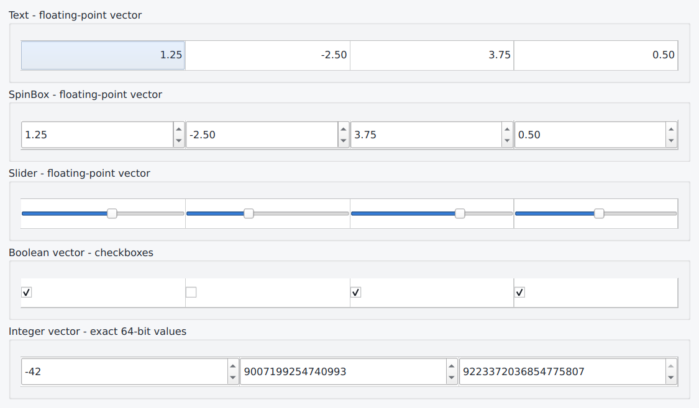
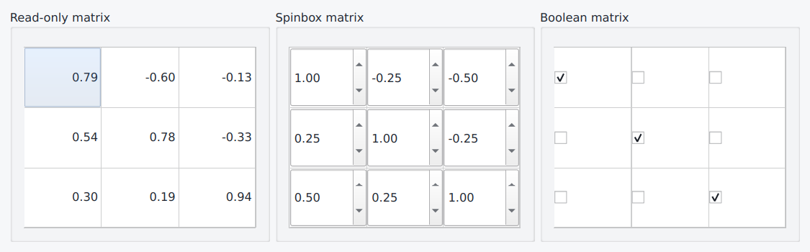
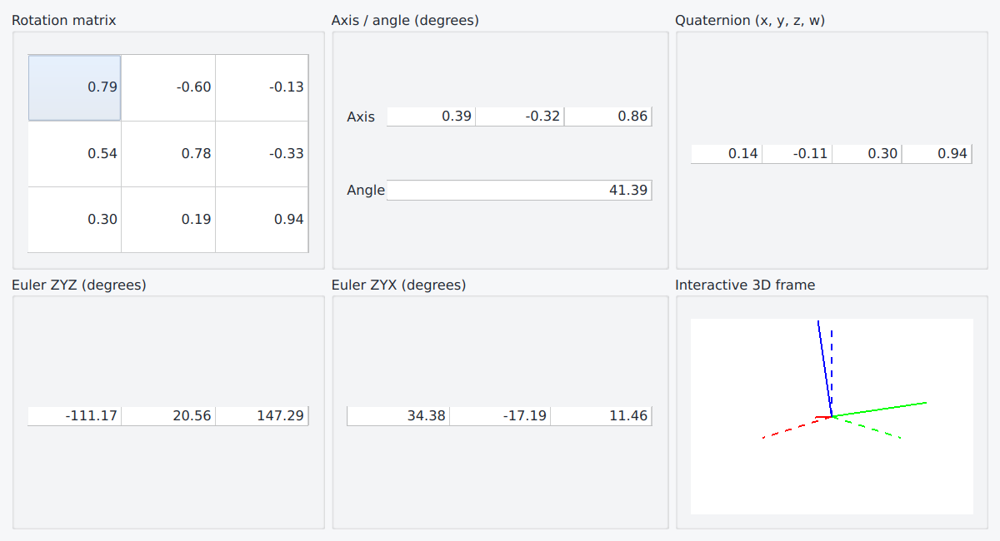
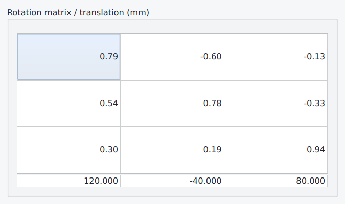
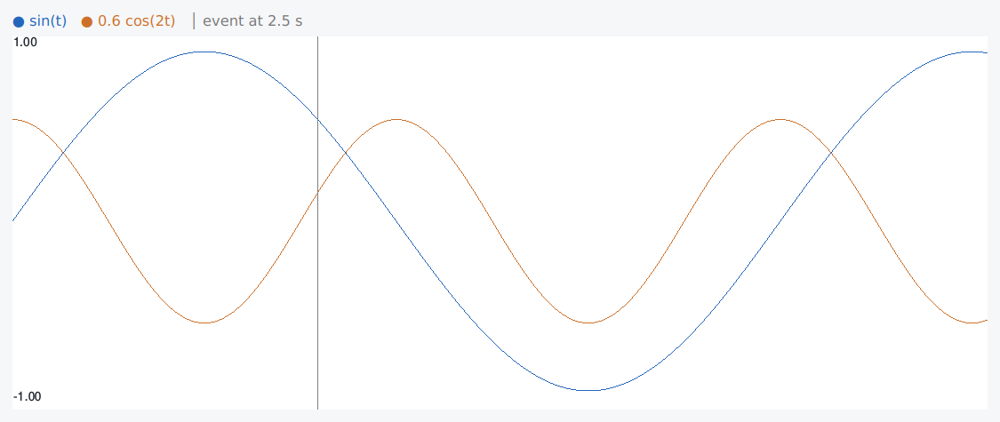
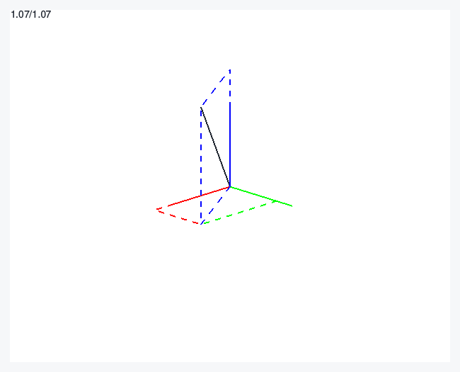
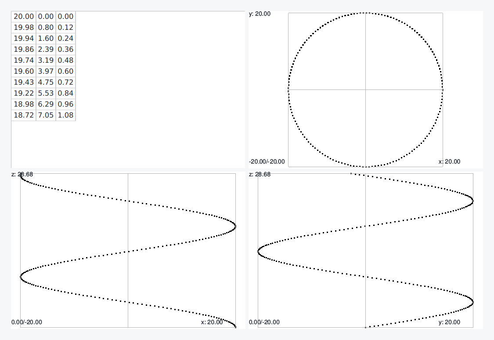
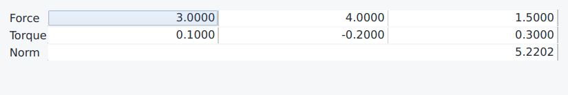
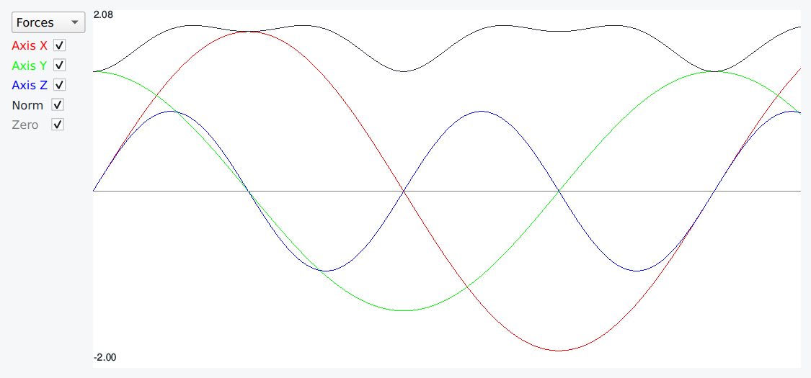
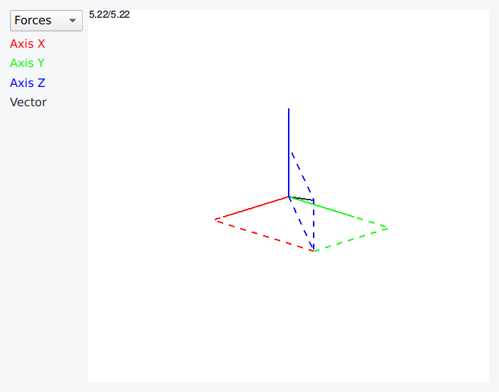

.. SPDX-License-Identifier: MIT
.. SPDX-FileCopyrightText: 2026 EigenQt contributors

Widget gallery
==============

These images are captured from the real Qt widgets with deterministic sample
data. They use the Fusion style and a light palette. Native platform styles and
fonts may look different. See :ref:`capture-screenshots` to regenerate the images.

Numeric editors
---------------

   VectorEditor: Text, SpinBox, Slider, Boolean, and full-width Integer input.

Matrix widgets
--------------

   MatrixView and MatrixEditor accept matrix-like objects and custom accessors.

Rotation representations
------------------------

   Six representations of the same rotation.

Frame display
-------------

   FrameWidget combines a RotationWidget and a translation VectorView.

Streaming plot
--------------

   Plot2DWidget with a shared scale and Y-range labels.

3D vector
---------

   Vector3DWidget includes mouse rotation and automatic scaling.

Positions
---------

   PositionsWidget keeps the added positions until clear() is called.

Wrench text
-----------

   WrenchWidget in Text mode.

Wrench time series
------------------

   WrenchWidget in Plot2D mode.

Wrench 3D
---------

   WrenchWidget in Plot3D mode.
