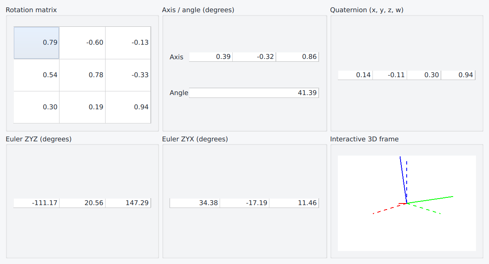
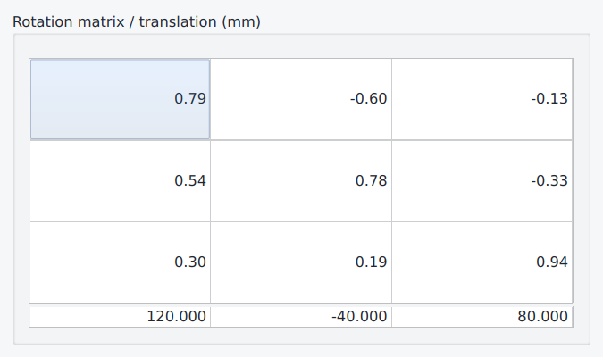
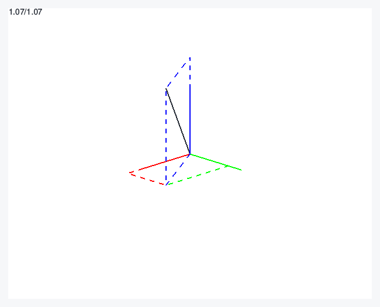
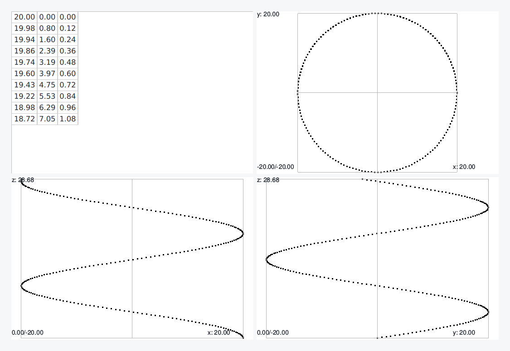
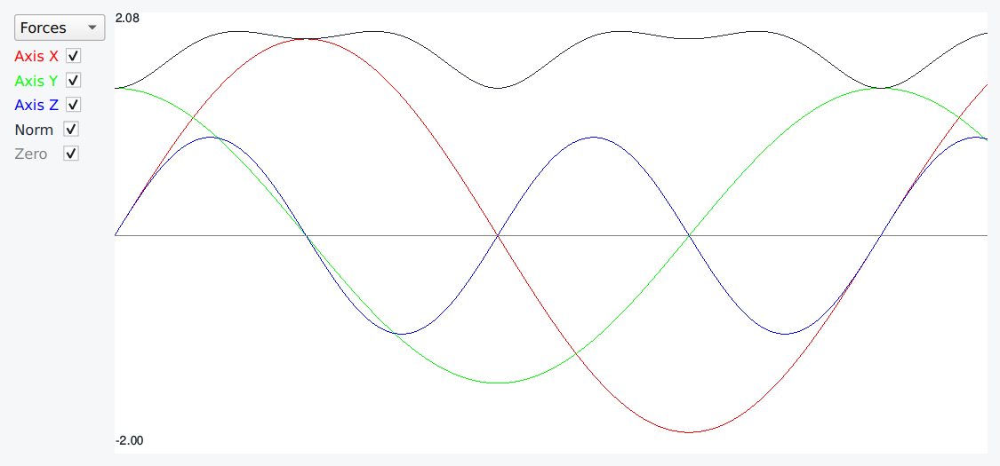

.. SPDX-License-Identifier: MIT
.. SPDX-FileCopyrightText: 2026 EigenQt contributors

Geometry and wrench widgets
===========================

Link ``EigenQt::Geometry`` for these widgets. Inputs use Eigen vectors,
rotation matrices, and isometries. Rotations are assumed to be valid orthonormal
matrices; the widgets do not validate or normalize them.

Rotations
---------

``EigenQt::RotationWidget`` displays the same rotation as a matrix, axis/angle,
quaternion, Euler ZYZ angles, Euler ZYX angles, or a 3D coordinate frame. Include
``<EigenQt/RotationWidget>``.

   The display mode changes the representation while retaining the input rotation.

.. code-block:: cpp

   #include <EigenQt/RotationWidget>

   EigenQt::RotationWidget rotation(EigenQt::RotationWidget::Quaternion, parent);
   rotation.setValue(Eigen::AngleAxisd(0.6, Eigen::Vector3d::UnitZ()));
   rotation.setDisplayMode(EigenQt::RotationWidget::AxisAngle);

``setValue()`` accepts any 3×3 Eigen matrix expression (``Eigen::Matrix3d``,
``Eigen::Matrix3f``, blocks) as well as any 3D ``Eigen::RotationBase``
representation (``Eigen::Quaterniond``/``f``, ``Eigen::AngleAxisd``/``f``, and
``Eigen::EulerAngles``). The modes are ``RotationMatrix``, ``AxisAngle``,
``Quaternion``, ``EulerZYZ``, ``EulerZYX``, and ``OpenGL``. Quaternion order is
**x, y, z, w**. Angles are shown in degrees by default.
``setPrismaticRevoluteFactors(1.0, 1.0)`` switches angular display to radians;
the first factor is unused for a rotation-only widget.

Right click to select a representation. ``displayMode`` is a writable Qt property,
and ``displayModeChanged(mode)`` reports changes. ``value()`` returns the stored
rotation matrix. In 3D mode, drag with the left mouse button to rotate the viewing
orientation and press **Z** to reset it. ``EigenQt::RotationView`` provides the 3D
view directly through the same header.

Frames
------

``EigenQt::FrameWidget`` combines a rotation representation and a translation row.
Include ``<EigenQt/FrameWidget>``.

   Frame inputs use an Eigen isometry; display units are configurable.

.. code-block:: cpp

   #include <EigenQt/FrameWidget>

   EigenQt::FrameWidget frame(EigenQt::RotationWidget::RotationMatrix, parent);
   Eigen::Isometry3d pose = Eigen::Isometry3d::Identity();
   pose.translation() = Eigen::Vector3d(0.12, -0.04, 0.08);
   frame.setValue(pose);

``FrameWidget::setValue()`` accepts 3D Eigen transforms (``Eigen::Isometry3d``/``f``,
``Eigen::Affine3d``/``f``, ``Eigen::AffineCompact3d``/``f``), 4×4 homogeneous
matrices (``Eigen::Matrix4d``/``f``), or a ``(rotation, translation)`` pair using
any rotation representation supported by ``RotationWidget`` and a 3-element
Eigen vector.

Translation is multiplied by 1,000 by default, suitable for inputs in meters and
display in millimeters. ``setPrismaticRevoluteFactors(prismatic, revolute)``
changes the translation and angular display multipliers and immediately refreshes
both views. ``value()`` returns the stored isometry, and the frame forwards the
rotation display-mode property and signal.

Vectors and positions
---------------------

``EigenQt::Vector3DWidget`` shows an ``Eigen::Vector3d`` with colored axes and
coordinate projections. Include ``<EigenQt/Vector3DWidget>``.
``setAutoResize(true)`` resets the scale and expands it for larger vector norms.
``maximumNorm()`` reports the scale's current maximum, and ``axisLength()``
provides access to the reference-axis length.

   Drag to rotate the viewing orientation; press Z to reset it.

``EigenQt::PositionsWidget`` displays 3D positions (such as a set of tracked
fiducials or a sampled trajectory) projected onto the XY, XZ, and YZ planes,
along with a table of the first ten positions. Include
``<EigenQt/PositionsWidget>``. ``setValue(Eigen::Vector3d)`` adds
a point; the isometry overload uses only translation. ``clear()`` clears both the
points and table.

   Each projection can be controlled independently using its keyboard shortcuts.

For a vector view, **A** toggles automatic scaling and **R** resets its scale.
Positions views also use **A** and **R**, plus **1**, **2**, and **3** to
select XY, XZ, or YZ projection. Click a view to give it keyboard focus first.

Force and torque
----------------

``EigenQt::WrenchWidget`` combines text, time-series, and 3D views. Include
``<EigenQt/WrenchWidget>``.

.. code-block:: cpp

   #include <EigenQt/WrenchWidget>

   EigenQt::WrenchWidget wrench(EigenQt::WrenchWidget::Text, parent);
   wrench.setValue(Eigen::Vector3d(3.0, 4.0, 0.0),
                   Eigen::Vector3d(0.1, 0.2, 0.3), 12.5);
   wrench.setDisplayMode(EigenQt::WrenchWidget::Plot2D);

The third argument is the timestamp used for the time-series view. Modes are
``Text``, ``Plot2D``, and ``Plot3D``; the constructor defaults to ``Plot3D``.
Right click to change modes. ``force()``, ``torque()``, and ``timestamp()`` return
the stored sample. ``displayMode`` and ``displayModeChanged(mode)`` follow the
same Qt conventions as the rotation widget.

   The selector switches between force and torque; checkboxes select traces.

``EigenQt::WrenchPlotWidget`` and ``EigenQt::Wrench3DWidget`` expose the individual
plot views through their correspondingly named headers. The 2D plot records both
force and torque signals while that view receives updates. It does not
reconstruct history collected while another representation was selected.

See the :doc:`gallery` for screenshots of all three wrench representations.
