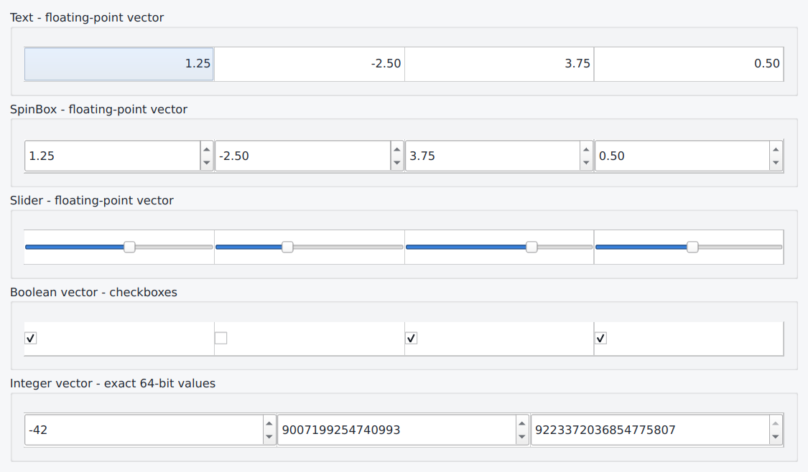

.. SPDX-License-Identifier: MIT
.. SPDX-FileCopyrightText: 2026 EigenQt contributors

EigenQt
=======

EigenQt provides Qt widgets for Eigen vectors and matrices, streaming plots,
rotations, frames, positions, and force/torque data. It uses C++17 and
supports Qt 5.15 and Qt 6. Eigen 3.4 is required by all components. There is no
cisst or ROS dependency.

The same numeric widget accepts fixed and dynamic containers of different
arithmetic types. Use Eigen values, STL containers, Qt containers, or iterators
without choosing a float/double or fixed/dynamic widget specialization.

   Numeric editors infer their controls from the input element type.

All builds include the following libraries:

.. list-table:: Libraries
   :header-rows: 1
   :widths: 16 52 32

   * - Component
     - Features
     - Dependencies
   * - ``Widgets``
     - Vector and matrix views and editors
     - Qt Widgets, Eigen 3.4
   * - ``Plot``
     - Streaming signals, circular buffers, scales, reference lines and fitting
     - Widgets, Eigen 3.4, desktop OpenGL
   * - ``Geometry``
     - Rotations, frames, vectors, positions and wrench displays
     - Plot, Eigen 3.4

Start with :doc:`installation`, explore the :doc:`gallery`, or go directly to
:doc:`numeric-widgets` for the container API.

.. toctree::
   :maxdepth: 2
   :caption: User guide

   installation
   numeric-widgets
   plotting
   geometry
   gallery

.. toctree::
   :maxdepth: 2
   :caption: Project

   development
   license
