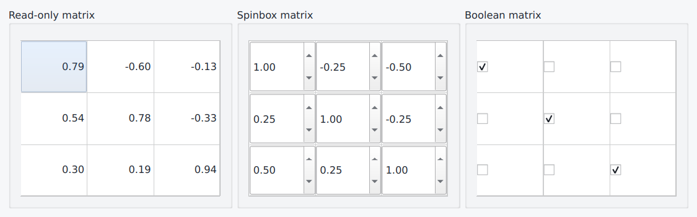

.. SPDX-License-Identifier: MIT
.. SPDX-FileCopyrightText: 2026 EigenQt contributors

Numeric views and editors
=========================

Four concrete Qt classes cover numeric containers:

.. list-table:: Public widgets
   :header-rows: 1
   :widths: 25 35 40

   * - Class
     - Header
     - Purpose
   * - ``EigenQt::VectorView``
     - ``<EigenQt/VectorView>``
     - Display a vector in one row
   * - ``EigenQt::VectorEditor``
     - ``<EigenQt/VectorEditor>``
     - Edit a vector; default mode is Text
   * - ``EigenQt::MatrixView``
     - ``<EigenQt/MatrixView>``
     - Display a matrix
   * - ``EigenQt::MatrixEditor``
     - ``<EigenQt/MatrixEditor>``
     - Edit a matrix; default mode is SpinBox

Link ``EigenQt::Widgets``, which publicly requires Eigen 3.4. The widgets
derive from ``NumericTableWidget`` and ``QTableWidget``, so normal Qt sizing,
parent ownership, and table styling apply.

   Matrix display and editing use the same container-independent API.

Vectors and iterators
---------------------

.. code-block:: cpp

   #include <EigenQt/VectorEditor>
   #include <Eigen/Core>

   EigenQt::VectorEditor editor(EigenQt::VectorEditor::SpinBox, parent);
   editor.setRange(-10.0, 10.0);
   editor.setValue(Eigen::Vector3f(1.25f, 2.5f, -3.0f));

   Eigen::Vector3d output;
   if (!editor.readValues(output)) {
       // Handle invalid input or a conversion/dimension error.
   }

``setValue(container)`` uses ``begin``/``end`` and copies the input immediately.
The widget retains no caller references or iterators. ``setValues(first, last)``
accepts readable input iterators, including stream iterators.
``readValues(first, last)`` requires writable forward iterators and exactly the
displayed number of elements. Output containers must already have the right size.

``std::array``, ``std::vector``, ``std::list``, C arrays, Qt containers, and
Eigen vectors are examples of supported inputs. Packed ``std::vector<bool>``
references are supported. To allocate a correctly sized result:

.. code-block:: cpp

   auto output = editor.values<double>(); // std::optional<std::vector<double>>
   if (output) {
       // Use *output.
   }

Element types and controls
--------------------------

The input element type determines the numeric family, available through the
``numberType`` Qt property. A widget can accept a different type on a later call.

.. list-table:: Inferred behavior
   :header-rows: 1

   * - Input
     - Behavior
   * - ``bool``
     - Checkboxes in editors; ``0``/``1`` in views
   * - Signed integers through 64 bits
     - Exact signed storage and integer controls
   * - Unsigned integers through 64 bits
     - Exact unsigned storage and integer controls
   * - ``float`` and ``double``
     - Floating-point controls with configurable precision

Choose ``Text``, ``SpinBox``, or ``Slider`` in the editor constructor; booleans
always use checkboxes. Display mode is fixed for the lifetime of a numeric editor.
Use ``setPrecision(int)`` for decimal places and ``setFormat(char)`` for textual
floating-point formatting (``e``, ``E``, ``f``, ``F``, ``g``, or ``G``).
``setBase(int)`` selects integer bases from 2 through 36. ``setStep(value)`` sets
the spinbox increment; integer controls use a step of one when a fractional
floating-point step cannot be represented as an integer.

``setRange(minimum, maximum)`` applies uniform limits. Container overloads set
per-element limits, flattened in row-major order for matrices. Slider controls
use 1,001 positions across their configured range, so slider motion is quantized.
Their default ranges are -100 to 100, or 0 to 100 for unsigned values.

Floating-point spinbox bounds are rounded inward to keep displayed values within
the requested limits. If the range contains no value at the selected precision,
``setValue()`` returns ``false``. Changing an existing editor to incompatible
precision or ranges throws ``std::invalid_argument`` and preserves its settings.

Matrices and strides
--------------------

Matrix-like objects provide ``rows()``, ``cols()``, and coefficient access through
``operator()(row, column)``. This includes Eigen matrices and blocks. For other
storage, provide dimensions and an accessor:

.. code-block:: cpp

   #include <EigenQt/MatrixEditor>

   EigenQt::MatrixEditor editor(parent);
   editor.setValues(2, 3,  {
       return double(3 * row + column);
   });

   double storage[12]{};
   EigenQt::StridedMatrixView<double> output(storage, 2, 3, 1, 4);
   editor.readValues(output);

Strides are measured in elements. The caller owns the underlying storage. The
example writes columns at offsets 0, 4, and 8, with rows one element apart.
``EigenQt::Matrix<T>`` supplies a small owning matrix when no matrix library is used.
The matrix helpers are declared by ``<EigenQt/Matrix>`` (or ``<eigenqt/Matrix.h>``)
and also included by the matrix widget headers.

For output through a custom setter, use
``readValues<T>(rows, columns, setter)`` with a callable accepting
``(row, column, value)``. Dimensions must match the displayed shape.

Conversion and signals
----------------------

Output conversions are validated before the destination is modified. Overflow,
fractional-to-integral conversion, negative-to-unsigned conversion, and loss of
integer precision return ``false``. Boolean output accepts only zero or one.
Conversions between floating-point types may round; display precision also limits
the value read from text and spinbox editors.

Setters block change signals by default, preserving an existing outer signal
block. Pass ``false`` as their final argument to emit ``valueChanged()`` when the
contents change. User edits emit the same signal:

.. code-block:: cpp

   QObject::connect(&editor, &EigenQt::VectorEditor::valueChanged, receiver, [&editor] {
       if (auto values = editor.values<double>()) {
           // Consume the edited values.
       }
   });

Use widgets on the GUI thread. Queue worker-thread data through Qt signals or
``QMetaObject::invokeMethod`` before updating the widgets.
