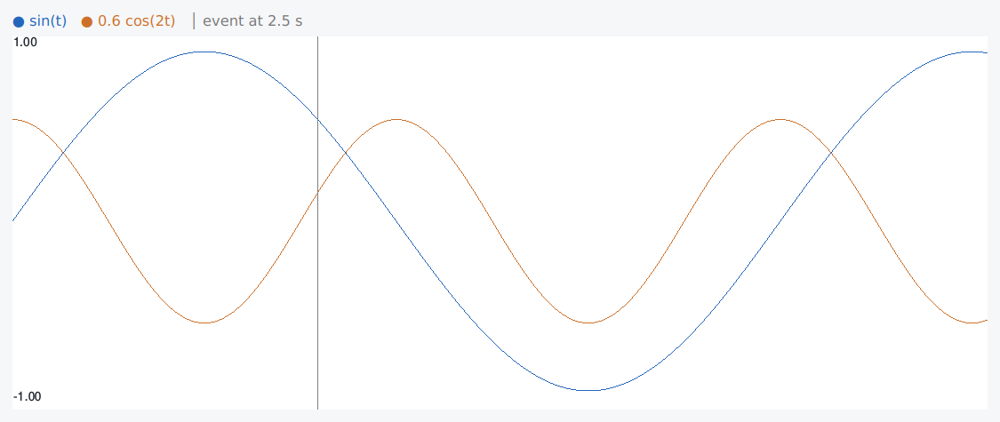

.. SPDX-License-Identifier: MIT
.. SPDX-FileCopyrightText: 2026 EigenQt contributors

Streaming plots
===============

``EigenQt::Plot2DWidget`` displays samples grouped into named scales. Each scale has
its own data-to-viewport transformation and can contain multiple signals and
vertical reference lines. Link ``EigenQt::Plot`` and include
``<EigenQt/Plot2DWidget>``.

   Signals on the same scale share viewing ranges and fitting behavior.

Create a plot
-------------

.. code-block:: cpp

   #include <EigenQt/Plot2DWidget>

   auto *plot = new EigenQt::Plot2DWidget(parent);
   plot->setNumberOfPoints(1000);
   auto *scale = plot->addScale("position");
   auto *signal = scale->addSignal("joint-1");
   signal->setColor(Eigen::Vector3d(0.1, 0.4, 0.8));
   plot->setDisplayYRangeScale(scale);

   signal->appendPoint(Eigen::Vector2d(time, position));
   plot->update();

Append samples and request a repaint from the GUI thread. For a batch, use
``appendPoints(first, last)``; each iterator value must support ``point[0]`` and
``point[1]``. Sample storage is an STL circular buffer. Eigen supplies the
coordinate transformations and the single-point API.

Adding a duplicate scale, signal, or reference-line name returns ``nullptr``.
Use ``findScale(name)`` to retrieve an existing scale and ``signalMap()`` to
inspect its signals. Returned pointers are borrowed: removing their owning scale
or signal invalidates them.

Buffer and sample operations
----------------------------

``setNumberOfPoints(n)`` sets the capacity of existing and future signals, with a
minimum of three. An individual signal can use ``setSize(n)`` to clear and resize
its buffer, or ``resize(n, trimOlder)`` to retain samples. The default
``trimOlder=true`` preserves the most recent samples when shrinking.

``pointCount()`` reports the number of samples and ``capacity()`` reports storage
capacity. ``pointAt(index)`` and ``setPointAt(index, point)`` use chronological
indices, starting with the oldest sample. Out-of-range access throws
``std::runtime_error``.

Fitting, visibility and reference lines
---------------------------------------

``setContinuousFitX(true)``, ``setContinuousFitY(true)``, and
``setContinuousExpandY(true)`` control automatic fitting. Fit-Y and expand-Y modes
are mutually exclusive. Expand-Y retains the largest observed range until reset.
Scale methods provide the same controls independently for each scale.

Use ``autoFitX()`` and ``autoFitY()`` for a one-time fit, or ``fitX(min, max)`` and
``fitY(min, max)`` for explicit viewing ranges. Scale methods also provide
``autoFitXY()`` and ``fitXY()``. The optional padding argument leaves space around
the plotted data.

.. code-block:: cpp

   scale->setContinuousFitX(true);
   scale->setContinuousExpandY(true);
   auto *event = scale->addVerticalLine("event");
   event->setX(2.5);
   event->setColor(Eigen::Vector3d(0.5, 0.5, 0.5));
   signal->setVisible(false);

Hidden signals are excluded from automatic data ranges. ``setFrozen(true)`` stops
new samples; unfreezing clears the buffered data. Freeze can be applied to an
individual signal, a scale, or the plot.

``setDisplayYRangeScale(scale)`` selects the scale whose Y limits appear as text.
The selection is stored by name: removing that scale hides the labels, and
recreating its name selects the new scale. Pass ``nullptr`` to disable labels.

Keyboard and mouse
------------------

* **Space** freezes or restarts collection.
* **R** resets continuous Y expansion.
* **Right click** opens fitting and freeze controls.

Rendering requirements
----------------------

The renderer uses legacy desktop OpenGL commands. It requires a compatible
desktop context and does not support OpenGL ES or an OpenGL core-only context.
This also applies to the 3D and positions widgets in :doc:`geometry`.
Configure the application's ``QSurfaceFormat`` before constructing its widgets
when a platform or application otherwise requests a core profile.
